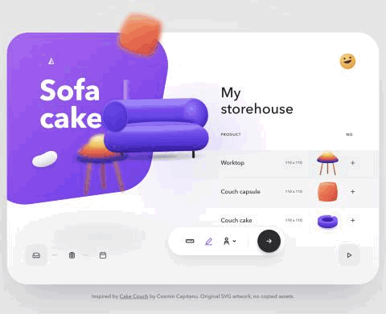
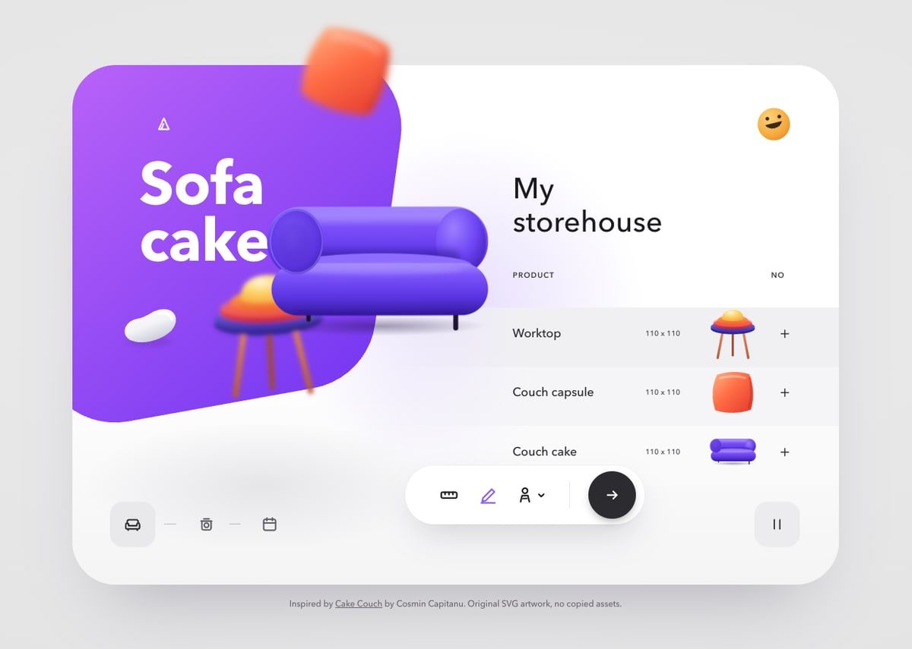

# Cake Couch

<p align="center">
  
</p>

**Live:** https://cake-couch-animation.vercel.app

A tiny, dependency-free animated product showcase in plain HTML, CSS and JavaScript with hand-drawn SVG. No framework, no fonts, no images, no build step (about 12 KB gzipped).



## How it moves
- Three themes (Sofa cake, Blob sofa, Herbs pods) cycle on a loop.
- Every object rides one hidden circle, clockwise. The old set sweeps out to the bottom-left while the new set swings in from the top; blurred foreground objects travel further, which gives depth.
- The coloured background is a rounded pentagon that rotates 144° per theme about the same centre. The card clips it, so its visible outline keeps changing while the colour morphs.
- The headline and the product rows slide out left as a strip and the new ones follow right behind.
- Pauses on hover, focus, hidden tab and the pause button. Honours `prefers-reduced-motion`.

## Run locally
```bash
python3 -m http.server 4173
```
Then open http://localhost:4173.

## Files
| File | What it holds |
|---|---|
| `index.html` | Markup and the SVG artwork (symbols reused by the hero and the list) |
| `style.css` | Layout, theme colours and all motion (CSS transitions and keyframes) |
| `app.js` | Builds the themes, runs the orbit, pentagon turn and autoplay |
| `og-image.jpg` | Social share picture (1200x630) |
| `docs/` | README animation (`cake-couch.gif`, recorded from the live page) and picture (`screenshot.jpg`) |

Inspired by [Cake Couch](https://dribbble.com/shots/16460483-Cake-Couch) by Cosmin Capitanu. All artwork here is original SVG; no assets were copied.
